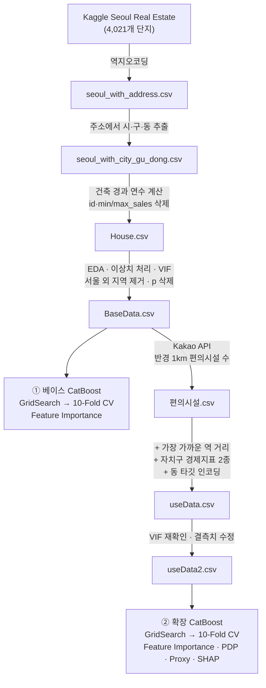
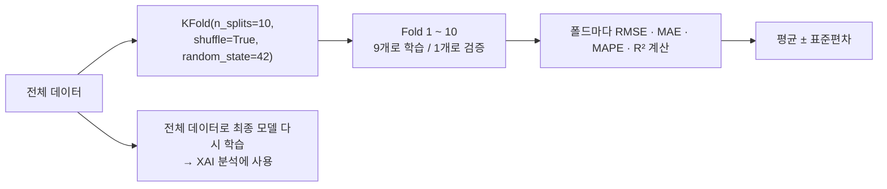

# 서울 아파트 매매가 예측 및 가격 형성 요인 분석 (XAI)

> **XAI 기법을 이용한 아파트 가격 예측 및 아파트 가격 형성 요인 분석** 

서울 아파트 단지의 **평균 매매가(`avg_sales`)**를 예측하는 회귀 모델을 만들고, **모델이 왜 그런 가격을 예측했는지**를 XAI 기법(SHAP, PDP, 대리 모델 등)으로 해석하는 프로젝트입니다.

- **모델**: CatBoost 회귀 (Gradient Boosting Decision Tree), 하이퍼파라미터는 GridSearch로 선정
- **검증**: 10-Fold 교차검증 (RMSE · MAE · MAPE · R²)
- **해석**: Feature Importance, SHAP, PDP, Decision Tree 대리 모델(Proxy)
- **실험 구성**: ① 단지 기본 정보만 쓴 **베이스 모델** → ② 동별 가격 수준·편의시설·지역 통계를 추가한 **확장 모델**을 비교

| 모델 | 변수 수 | 평균 RMSE | 평균 MAE | 평균 MAPE | 평균 R² |
|---|---|---|---|---|---|
| ① 베이스 CatBoost | 9 | 11,886 | 6,776 | 15.28% | 0.819 |
| ② 확장 CatBoost | 18 | **10,963** | **5,679** | **12.45%** | **0.846** |


**핵심 결론**: 서울 아파트 가격을 가장 크게 결정하는 것은 **위치(동별 평균 가격)**이고, 그다음이 **연식 · 면적 · 세대수**입니다. 편의시설 수나 역까지의 거리 같은 보조 변수는 기대만큼 성능을 올리지 못했습니다.

---

## 1. 사용 데이터

### 1-1. 데이터 출처

| 데이터 | 내용 | 출처 |
|---|---|---|
| **Seoul Real Estate Datasets** (`seoul - SeoulRealEstate.csv`) | 서울 등의 아파트 단지 정보 **4,021건**, 변수 11개 | [Kaggle — jcy1996/seoul-real-estate-datasets](https://www.kaggle.com/datasets/jcy1996/seoul-real-estate-datasets) |
| 서울시 가구증가율 (`2021_총가구증가율.csv`) | 자치구별 2021년 총가구 증가율 (%) | [서울 열린데이터광장](https://data.seoul.go.kr/bsp/wgs/gis/gis40.do) |
| 아파트매매거래 현황 (`아파트매매거래+현황_20251130155056.csv`) | 자치구별 2021년 아파트 매매 거래 수 | [서울 열린데이터광장](https://data.seoul.go.kr/dataList/10803/S/2/datasetView.do) |
| 서울시 역사 마스터 정보 (`서울시 역사마스터 정보.csv`) | 서울 지하철역 좌표 | [서울 열린데이터광장 (OA-21232)](https://data.seoul.go.kr/dataList/OA-21232/S/1/datasetView.do) |
| Kakao Local API (키워드 검색) | 단지 반경 **1km** 안의 학교·지하철역·공공기관·병원·대형마트 개수 | Kakao Developers |
| 역지오코딩 (좌표 → 주소) | 주소에서 시·구·동 추출 | 코드: OpenStreetMap **Nominatim** (`geopy`) / 보고서: 카카오 지도 API |


### 1-2. 원본 변수 (Kaggle 데이터)

| 변수 | 설명 | 사용 여부 |
|---|---|---|
| `id` | 식별키 | ❌ 예측에 불필요해서 삭제 |
| `lat`, `lng` | 위도, 경도 | ✅ (역지오코딩에도 사용) |
| `households` | 세대수 | ✅ |
| `buildDate` | 준공 연월 (YYYYMM) → **건축 경과 연수**로 변환 | ✅ |
| `score` | 단지 평점 | ✅ |
| `m2` | 면적 (m²) | ✅ |
| `p` | 층수 (보고서 기준) | ❌ 다중공선성 때문에 삭제 (아래 3-4 참고) |
| `min_sales`, `max_sales` | 최저 / 최고 매매가 | ❌ 사용하지 않음 |
| `avg_sales` | **평균 매매가 (목표 변수)** | 🎯 |

### 1-3. 최종 분석 변수

| 구분 | 변수 | 설명 | 베이스 | 확장 |
|---|---|---|:-:|:-:|
| **목표 변수** | `avg_sales` | 단지 평균 매매가 | 🎯 | 🎯 |
| 위치 | `lat`, `lng` | 위도, 경도 | ✅ | ✅ |
| 단지 | `households` | 세대수 | ✅ | ✅ |
| 단지 | `buildDate` | 건축 경과 연수 (2025-11 기준) | ✅ | ✅ |
| 단지 | `score` | 단지 평점 | ✅ | ✅ |
| 단지 | `m2` | 면적 (m²) | ✅ | ✅ |
| 행정구역 (범주형) | `city`, `gu`, `dong` | 시 / 자치구 / 행정동 | ✅ | ✅ |
| 지역 가격 수준 | `dong_te` | **동 단위 타깃 인코딩** (행정동별 `avg_sales` 평균) | | ✅ |
| 편의시설 (반경 1km) | `school_total`, `subway_total`, `public_total`, `hospital_total`, `mart_total` | 학교 / 지하철역 / 공공기관 / 병원 / 대형마트 개수 | | ✅ |
| 교통 | `subway_nearest_km` | 가장 가까운 지하철역까지의 거리 (Haversine, km) | | ✅ |
| 경제지표 | `household_growth_2021` | 자치구 총가구 증가율 (2021) | | ✅ |
| 경제지표 | `apt_transactions_2021` | 자치구 아파트 매매 거래 수 (2021) | | ✅ |

---

## 2. 전체 파이프라인



### 파일 구성

| 파일 | 역할 | 비고 |
|---|---|---|
| `아파트 가격 예측 보고서.docx` | 프로젝트 최종 보고서 (데이터 설명, 시각화, 분석 결과, 결론, 참고문헌) | |
| `(실행X)역지오코딩.ipynb` | Nominatim으로 좌표 4,021개를 주소로 변환 (요청마다 1초 대기) | 실행 시간이 길어서 결과 파일만 사용 |
| `(실행X)편의시설코드.py` | Kakao Local API로 단지별 반경 1km 편의시설 수 집계 | `API_KEY` 직접 입력 필요 |
| `XAI전처리.ipynb` | 시·구·동 추출, 건축 경과 연수, 결측치·지역 정리, 파생 변수 추가, VIF | |
| `XAI딥러닝모델.ipynb` | EDA, 다중공선성 분석, 베이스·확장 CatBoost 학습, 10-Fold CV, XAI | 이름은 "딥러닝"이지만 실제 모델은 CatBoost |

---

## 3. 데이터 전처리

### 3-1. 역지오코딩 · 파생 변수
- 위도·경도를 주소로 바꾸고, 주소를 쉼표로 나눈 뒤 `~시`, `~구`, `~동`으로 끝나는 부분을 `city`, `gu`, `dong`으로 저장합니다.
- `buildDate`(YYYYMM) → **건축 경과 연수** (2025년 11월 기준 경과 개월 수 ÷ 12)

### 3-2. 결측치 처리

| 변수 | 결측 수 | 처리 |
|---|---|---|
| `avg_sales` | 90 | 목표 변수라서 **해당 행 삭제** (주로 거래 기록이 없는 2021년 이후 준공 단지) |
| `city` | 4 | 원래 주소를 인터넷으로 확인해 **직접 입력** |
| `dong` | 10 | 원래 주소를 인터넷으로 확인해 **직접 입력** |
| `gu` | 61 | 구리시·의정부시·광명시처럼 행정구역에 '구'가 없는 지역 → **시 이름으로 대체** |

### 3-3. 이상치 처리
- **건축 경과 60년** (정동아파트, 1965년 준공), **세대수 9,510** (송파구 헬리오시티) → 실제로 있는 값이라 **유지**
- `m2` 또는 `p`가 **0**인 관측치 → 비현실적인 값이라 **삭제**
- `p`(층수)가 **70 이상**인 관측치 → 서울 최고층 아파트가 69층이므로 하나씩 검색해 **실제 층수로 수정**
- **서울 외 지역** (대구광역시, 광명시, 구리시, 의정부시) → 지역마다 법규와 시장 구조가 달라서 **제거** → 서울 단지 약 **3,659건**

### 3-4. 다중공선성 진단 · 해결 (VIF)
- 히트맵에서 `m2`와 `p`의 상관계수가 **0.9995**로 거의 같은 변수였습니다.
- VIF가 약 800~1,000 수준 (노트북 실행 결과 1,007.5)으로 **심각한 다중공선성**을 보였습니다.
- 행을 직접 살펴보니 `p`가 `m2`와 기계적인 규칙으로 짝지어져 있었습니다 (예: 18층 ↔ 58~59m², 23~24층 ↔ 76~79m²). 실제 값은 `m2 ÷ 3.3`, 즉 평수에 가깝습니다. 무작위로 고른 20개 단지를 실제 층수와 비교했더니 **하나도 맞지 않았습니다.**
- 그래서 **`p`를 삭제**했고, 이후 모든 변수의 VIF가 **2 미만**이 되었습니다. 변수를 추가한 확장 모델에서도 VIF는 모두 **4 미만**입니다 (`vif_table.png`).

---

## 4. 탐색적 데이터 분석 (EDA)

| 그림 (보고서) | 분석 | 주요 결과 |
|---|---|---|
| 그림 1 | 건축 경과 연수 히스토그램 | 지은 지 **20~30년** 된 단지가 가장 많음 |
| 그림 2 | 세대수 박스플롯 | Q1 78, Q3 452 → 대부분 **80~450세대** 단지 |
| 그림 3 | 면적 히스토그램 | **50~125m²**에 가장 많이 분포, 0인 값은 이상치 |
| 그림 4 | `p`(층수) 박스플롯 | 20~30에 집중, 범위는 0~85 → 0과 70 이상은 이상치 |
| 그림 5 | 평균 매매가 박스플롯 | 대부분 **31,000~54,500** 사이 |
| 그림 6 | 상관 히트맵 | `avg_sales`와 `m2` **+0.56**, `buildDate` **−0.33**, `m2`와 `p` **0.9995** (다중공선성) |
| 그림 7 | 시(city)별 데이터 수 | 서울 3,713 · 대구 241 · 광명 33 · 구리 24 · 의정부 6 |
| 그림 8 | 자치구별 데이터 수 | **영등포 · 양천 · 구로구**의 매물이 가장 많음 |
| 그림 9 | 자치구별 매매가 박스플롯 | **강남 · 서초구**의 가격이 두드러지게 높음 |

---

## 5. 모델링

### 5-1. 모델: CatBoostRegressor

**CatBoost를 고른 이유**
- `city`, `gu`, `dong` 같은 **범주형 변수**를 원-핫 인코딩 없이 그대로 처리할 수 있음 (Ordered Target Statistics 방식)
- 수천 건 규모의 정형 데이터에서 부스팅 계열 모델이 강하고, 주택 가격 평가에서도 효과가 확인됨 (Hong, 2020)
- `TreeExplainer` 기반 SHAP으로 정확하고 빠르게 해석할 수 있음

**하이퍼파라미터** — 보고서 기준 **GridSearch**로 최적 조합을 찾았습니다. (탐색 코드 자체는 노트북에 없고, 최종 값만 들어 있습니다.)

| 하이퍼파라미터 | ① 베이스 | ② 확장 |
|---|---|---|
| `depth` (트리 깊이) | 6 | 8 |
| `learning_rate` | 0.05 | 0.1 |
| `l2_leaf_reg` (L2 정규화) | 1 | 3 |
| `iterations` (트리 개수) | 1200 | 1200 |
| `loss_function` / `eval_metric` | RMSE | RMSE |
| `bagging_temperature` / `random_state` | 0 / 42 | 0 / 42 |
| 범주형 변수 | `city`, `gu`, `dong` | `city`, `gu`, `dong` |

### 5-2. 검증 방법: 10-Fold 교차검증



| 지표 | 계산식 | 의미 |
|---|---|---|
| **RMSE** | √(mean((y − ŷ)²)) | 큰 오차에 더 민감한 평균 오차 |
| **MAE** | mean(\|y − ŷ\|) | 평균 절대 오차 (가격 단위 그대로) |
| **MAPE** | mean(\|y − ŷ\| / y) × 100 | 평균 상대 오차 (%), y = 0인 행은 제외 |
| **R²** | 1 − SS_res / SS_tot | 설명된 분산의 비율 |

### 5-3. 결과

| 모델 | RMSE | MAE | MAPE | R² |
|---|---|---|---|---|
| ① 베이스 | 11,885.9 ± 3,401.7 | 6,775.6 ± 727.4 | 15.28% ± 0.83 | 0.819 ± 0.048 |
| ② 확장 (노트북) | 10,963.2 ± 3,452.3 | 5,678.9 ± 818.5 | 12.45% ± 1.04 | 0.846 ± 0.048 |
| ② 확장 (보고서) | 10,950.9 | 5,594.4 | 13.38% | 0.843 |

- 베이스 모델은 실제 값과 약 **15%**의 오차를 보이며, 데이터 변동의 **81.9%**를 설명합니다.
- 변수를 추가하자 오차율이 **약 13% 이하**로 줄고, 설명력이 **84%대**로 올랐습니다.

<details>
<summary>폴드별 상세 결과 (노트북)</summary>

| Fold | ① RMSE | ① MAPE | ① R² | ② RMSE | ② MAPE | ② R² |
|---|---|---|---|---|---|---|
| 1 | 16,365.8 | 14.41% | 0.775 | 14,778.1 | 11.73% | 0.817 |
| 2 | 19,153.7 | 16.61% | 0.715 | 18,677.9 | 14.13% | 0.729 |
| 3 | 8,928.0 | 14.00% | 0.869 | 7,967.2 | 11.51% | 0.895 |
| 4 | 9,314.7 | 14.56% | 0.836 | 8,106.4 | 11.07% | 0.876 |
| 5 | 10,725.3 | 15.95% | 0.837 | 8,327.6 | 12.54% | 0.902 |
| 6 | 11,182.2 | 16.04% | 0.848 | 12,045.4 | 14.01% | 0.824 |
| 7 | 9,381.1 | 15.09% | 0.844 | 8,496.2 | 12.28% | 0.872 |
| 8 | 13,268.6 | 14.81% | 0.816 | 12,849.9 | 12.93% | 0.827 |
| 9 | 7,798.5 | 15.13% | 0.876 | 7,789.4 | 11.21% | 0.876 |
| 10 | 12,740.9 | 16.23% | 0.774 | 10,593.7 | 13.11% | 0.844 |

1·2번 폴드는 두 모델 모두 RMSE가 크고 R²가 낮습니다. 고가 단지(이상치)가 이 폴드들에 몰렸을 가능성이 있습니다.

</details>

---

## 6. 변수 추가 (확장 모델)

베이스 모델도 성능이 양호했지만, 예측력을 더 높이려고 **9개 변수**를 추가했습니다.

1. **`dong_te` (동별 평균 가격)** — 행정동이 **332개**나 되어 단순한 범주형 변수로는 지역별 가격 수준을 충분히 반영하기 어렵습니다. 그래서 동마다 평균 거래가격을 계산해 그 동의 모든 단지에 같은 값을 넣었습니다 (타깃 인코딩).
2. **편의시설 6종** — Kakao API로 반경 1km 안의 학교·지하철역·공공기관·대형마트·병원 수, 그리고 가장 가까운 지하철역까지의 거리
3. **경제지표 2종** — 가구 증가율, 아파트 매매 거래 수 (서울 열린데이터광장, 2021, 자치구 단위로 병합)

---

## 7. 설명 가능한 AI (XAI) 분석

| 기법 | 도구 | 무엇을 보는가 |
|---|---|---|
| **Feature Importance** | `CatBoost.get_feature_importance` | 모델 전체에서 각 변수의 기여도 |
| **PDP** (Partial Dependence Plot) | `sklearn.inspection.PartialDependenceDisplay` | 한 변수만 바꿨을 때 예측값이 평균적으로 어떻게 변하는지 (경향성, 인과관계는 아님) |
| **대리 모델** (Proxy / Global Surrogate) | `DecisionTreeRegressor(max_depth=3)` | CatBoost 예측값을 깊이 3짜리 트리로 흉내 내서 의사결정 패턴을 단순하게 요약 |
| **SHAP** | `shap.TreeExplainer` | 게임이론의 Shapley 값으로 개별 예측에 대한 변수별 기여도를 계산. 영향의 **방향(+/−)**과 변수 사이의 상호작용까지 반영 |

> `lime` (`LimeTabularExplainer`)도 import되어 있지만 실제로 실행되지는 않습니다.

### 7-1. ① 베이스 모델 — Feature Importance

| 순위 | 변수 | 중요도 |
|---|---|---|
| 1 | `m2` (면적) | 27.2 |
| 2 | `gu` (자치구) | 20.0 |
| 3 | `buildDate` (건축 경과 연수) | 18.1 |
| 4 | `dong` | 9.2 |
| 5 | `households` | 8.3 |
| 6 | `lng` / `lat` | 6.5 / 6.1 |
| 7 | `score` | 4.5 |

→ **면적 · 구 · 연식**이 집값 예측의 주요 지표입니다. 대리 트리 중요도는 `m2` 0.77 · `buildDate` 0.20 · `lat` 0.03입니다.

### 7-2. ② 확장 모델

**Feature Importance (상위 10개, 노트북 / 보고서)**

| 순위 | 변수 | 노트북 | 보고서 |
|---|---|---|---|
| 1 | `dong_te` | 26.9 | 26.0 |
| 2 | `m2` | 19.7 | 20.3 |
| 3 | `buildDate` | 17.1 | 16.5 |
| 4 | `households` | 7.8 | 8.4 |
| 5 | `hospital_total` | 3.0 | 3.9 |
| 6 | `gu` | 2.3 | 3.8 |
| 7 | `subway_nearest_km` | 3.2 | 3.6 |
| 8 | `lat` | 3.3 | 3.0 |
| 9 | `score` | 3.9 | 2.8 |
| 10 | `household_growth_2021` | 1.4 | 2.3 |

**PDP** (`m2`, `buildDate`, `households`, `dong_te`)
- 면적이 넓을수록, 동 평균 가격이 높을수록, 신축일수록 가격이 **올라가는 경향**이 뚜렷합니다.
- `households`는 **비선형**입니다. 약 **400세대까지 가파르게 오르다가 500세대 부근부터 완만해집니다.** 대단지에서는 세대수가 더 늘어나도 가격에 미치는 영향이 작아집니다.

**대리 모델 (Decision Tree, depth 3)**
- 중요도: `dong_te` 0.65 · `buildDate` 0.18 · `m2` 0.17
- 원래 모델의 상위 3개 변수가 대리 모델에서도 핵심 변수로 쓰였습니다 → 두 모델의 판단이 **일관됨**

**SHAP**
- 전체 중요도(bar): **`dong_te` > `buildDate` > `m2` > `households`**. 다른 기법들과 달리 연식이 면적보다 위에 옵니다. SHAP이 변수 사이의 의존성과 음의 기여까지 반영하기 때문으로 해석됩니다.
- 영향 방향(beeswarm)
  - `dong_te`: 비싼 동에서는 예측값을 크게 올리고, 싼 동에서는 크게 내림
  - `buildDate`: 신축일수록 올리고, 오래될수록 크게 내림
  - `m2`: 면적이 넓을수록 꾸준히(선형적으로) 올림
  - `households`: 대단지에서 조금 올리지만 영향은 상대적으로 작음

### 7-3. 해석 요약
- 베이스 모델에서 `gu`, `dong`, `lat`, `lng`가 나눠 맡던 **"입지" 정보를 `dong_te`가 거의 혼자 흡수**했습니다 (`gu` 20.0 → 2~4).
- 집값을 결정하는 가장 큰 요인은 **크기도 역세권도 아닌 "위치"**이고, 그다음이 연식 · 면적 · 세대수입니다.
- 편의시설과 경제지표는 각각 1~4% 정도로 기여가 작습니다.

---

## 8. 한계 및 주의사항

- **타깃 인코딩 누수 (`dong_te`)** — 동별 평균 가격을 **교차검증 전에 전체 데이터로** 계산했습니다. 그래서 검증 폴드에 있는 단지의 가격이 `dong_te`에 이미 들어가 있고, 확장 모델의 성능과 `dong_te`의 중요도가 **실제보다 크게 나왔을 수 있습니다.** 제대로 하려면 폴드마다 학습 폴드로만 인코딩을 계산(out-of-fold)해야 합니다.
- **조기 종료 시 검증 폴드 사용** — `fit(..., eval_set=valid_pool, use_best_model=True)`가 검증 폴드를 보고 가장 좋은 반복 횟수를 고르기 때문에, CV 점수가 조금 낙관적으로 나옵니다.
- **GridSearch 코드 없음** — 보고서에는 GridSearch를 했다고 되어 있지만 노트북에는 최종 값만 있습니다.
- **Feature Importance 계산 데이터** — `get_feature_importance(train_pool)`에 마지막 폴드의 학습 데이터가 들어갑니다 (최종 모델은 전체 데이터로 학습).
- **공간 자기상관** — 무작위 KFold라서 같은 동네의 단지가 학습과 검증에 함께 들어갑니다. 처음 보는 지역에 대한 성능은 지역 단위로 나눠서(예: GroupKFold) 따로 평가해야 합니다.
- **시점 차이** — 건축 경과 연수는 2025년 11월 기준, 경제지표는 2021년 기준입니다. 경제지표는 자치구 단위라서 같은 구의 단지는 모두 같은 값을 가집니다.
- **역지오코딩 방식 불일치** — 보고서에는 카카오 지도 API로 되어 있지만, 저장소의 코드는 Nominatim(OpenStreetMap)을 사용합니다.

### 개선 방향 (보고서)
- 편의시설 수, 역까지의 거리 같은 보조 변수는 기대만큼 성능을 올리지 못했습니다. 부동산 시장 요인을 더 깊이 이해하고, **더 전문적인 경제지표**로 변수를 다시 고르면 모델과 해석을 더 정교하게 만들 수 있습니다.

---

## 9. 실행 방법

### 환경

```bash
pip install pandas numpy matplotlib seaborn scikit-learn catboost shap lime statsmodels haversine chardet geopy requests tqdm
```

- 그래프의 한글 표시를 위해 `Malgun Gothic` 폰트를 사용합니다 (Windows 기준).

### 실행 순서

1. [1-1. 데이터 출처](#1-1-데이터-출처)의 CSV를 내려받아 노트북과 같은 폴더에 둡니다.
2. _(선택, 오래 걸림)_ `(실행X)역지오코딩.ipynb` → `seoul_with_address.csv`
3. `XAI전처리.ipynb` 위쪽 셀 → `seoul_with_city_gu_dong.csv`, `House.csv`, `BaseData.csv`
4. _(선택, Kakao API 키 필요)_ `(실행X)편의시설코드.py`의 `API_KEY`를 채우고 실행 → `편의시설.csv`
5. `XAI전처리.ipynb` 아래쪽 셀 → `useData.csv` (직접 결측치를 수정한 `useData결측치수정.csv` 필요)
6. `XAI딥러닝모델.ipynb` — EDA · VIF (`House.csv`) → 베이스 모델 (`BaseData.csv`) → 확장 모델 (`useData2.csv`)


---

## 10. 기술 스택

| 분류 | 라이브러리 |
|---|---|
| 데이터 처리 | pandas, numpy |
| 시각화 | matplotlib, seaborn |
| 통계 | statsmodels (VIF) |
| 모델링 | catboost, scikit-learn (KFold, metrics, DecisionTree, PDP) |
| 해석 (XAI) | shap, lime (import만 함) |
| 공간 · 외부 데이터 | geopy (Nominatim), haversine, Kakao Local REST API |

---

## 11. 참고문헌

- 고종완. (2014). 서울시 아파트 매매시장 유형별 가격변동 영향요인 분석. *부동산학보*, 58, 116-127.
- 장세웅, 이상효, 김재준. (2009). 인지요인이 공동주택가격에 미치는 영향요인 분석 연구. *대한건축학회 논문집 - 계획계*, 25(3), 207-214.
- 김학현, 유환규, 오하영. (2023). 딥러닝과 머신러닝을 이용한 아파트 실거래가 예측. *정보처리학회 논문지*, 12(2), 59-76.
- Hong, J. (2020). An Application of XGBoost, LightGBM, CatBoost Algorithms on House Price Appraisal System. *Housing Finance Research*, 4, 33-64.
